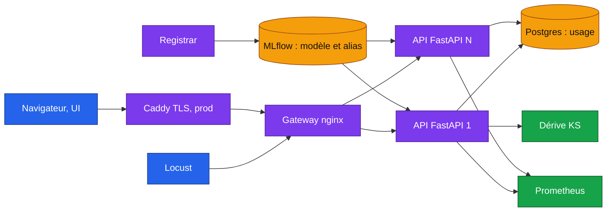

# eurosat-mlops

<!-- adam-badges:start -->
[](CHANGELOG.md)
[](https://github.com/Adam-Blf/eurosat-mlops/actions/workflows/ci.yml)
[](https://github.com/Adam-Blf/eurosat-mlops/commits)
[](LICENSE)
[](https://colab.research.google.com/github/Adam-Blf/eurosat-mlops/blob/main/notebooks/train_colab.ipynb)
<!-- adam-badges:end -->

Mise en production d'un classifieur d'occupation des sols sur images satellite Sentinel-2 (EuroSAT, 10 classes). Projet du cours MLOps du Mastère Data Engineering et IA de l'EFREI, réalisé en binôme.

Le modèle est un ResNet18 affiné, exporté en ONNX puis quantifié en int8. Il est servi par une API FastAPI protégée par jeton, versionné dans MLflow, surveillé par un détecteur de dérive et Prometheus, et déployable en une commande sur une VM créée par Terraform ou sur Kubernetes avec un canary.

**Rapport** : [`reports/rapport-eurosat-mlops.pdf`](reports/rapport-eurosat-mlops.pdf), 10 pages, généré par `python -m eurosat_mlops.report` (`pip install -e ".[report]"`) à partir des fichiers de résultats du dépôt et vérifié par `python scripts/check_report.py`.

## Résultats

| Modèle | Taille (Mo) | Accuracy | F1 macro | Médiane ms (batch 1) | p95 ms | Accélération |
|---|---|---|---|---|---|---|
| fp32 | 44,72 | 0,9795 | 0,9788 | 8,12 | 40,32 | 1,00x |
| int8 dynamique | 11,24 | 0,9798 | 0,9791 | 181,19 | 231,38 | 0,04x |
| **int8 statique (servi)** | 11,30 | 0,9780 | 0,9773 | 2,43 | 5,53 | 3,34x |

La quantization statique divise la taille par quatre et la latence par trois pour 0,15 point d'accuracy. La quantization dynamique, elle, ralentit le modèle sur CPU : les convolutions restent en float et on paie la quantization des activations à chaque appel. Détail dans [`docs/results/quantization.md`](docs/results/quantization.md), matrice de confusion dans [`docs/results/`](docs/results/).

Test de charge Locust contre la stack complète, gateway nginx devant N répliques de l'API :

| Répliques API | Requêtes | Échecs | req/s | Médiane ms | p95 ms | p99 ms |
|---|---|---|---|---|---|---|
| 1 | 2 288 | 0 | 53,0 | 210 | 380 | 550 |
| 2 | 2 516 | 0 | 59,2 | 140 | 370 | 500 |
| 4 | 2 886 | 0 | 67,7 | 95 | 320 | 490 |

Rapports HTML dans [`loadtest/results/`](loadtest/results/).

## Couverture du sujet

| Niveau | Exigence | Où |
|---|---|---|
| 0 | Toute la stack en une commande, en conteneurs | `docker compose up --build` |
| 1 | Déploiement automatique sur une VM existante | `scripts/deploy.py`, workflow `deploy.yml` |
| 1 | Accès refusé sans jeton dans l'en-tête | `api/auth.py`, `Authorization: Bearer <jeton>` |
| 1 | Usage suivi par utilisateur | `api/usage.py`, route `/usage` |
| 1 | Test de charge | `loadtest/locustfile.py`, `scripts/loadtest_scaling.py` |
| 2 | VM créée par Terraform | `infra/terraform/` (Hetzner Cloud) |
| 2 | Interface utilisateur | `ui/`, glisser-déposer servi par la gateway |
| 2 | Détection de dérive | `drift/`, test KS par caractéristique, route `/drift` |
| 2 | MLflow pour versionner et promouvoir | `registry.py`, alias `production` et `candidate` |
| 3 | Quantization | `quantize.py`, int8 statique servi |
| 3 | Scaling horizontal | `API_REPLICAS`, gateway nginx, mesures ci-dessus |
| 3 | Canary deployment sur Kubernetes | `k8s/overlays/canary` |

## Architecture



Le service `registrar` publie le modèle ONNX dans MLflow au démarrage et pose l'alias `production`. Chaque réplique de l'API charge le modèle désigné par cet alias, si bien que promouvoir une nouvelle version revient à déplacer l'alias. Toutes les images tournent en lecture seule, sans capacités Linux, sous un utilisateur non root.

## Lancer en local

```bash
cp .env.example .env              # jetons et mot de passe de démo à remplacer
docker compose up --build
```

| Service | Adresse |
|---|---|
| UI et API (gateway) | http://127.0.0.1:8080 |
| MLflow | http://127.0.0.1:5000 |
| Prometheus | http://127.0.0.1:9090 |

Les ports n'écoutent que sur `127.0.0.1`. Exemple d'appel :

```bash
curl -H "Authorization: Bearer demo-token-alice" -F file=@tuile-sentinel2.jpg http://127.0.0.1:8080/api/predict
```

| Route | Accès | Rôle |
|---|---|---|
| `GET /health`, `/ready` | libre | sondes de vie et de disponibilité |
| `POST /predict` | jeton | classe, probabilités, latence |
| `GET /model` | jeton | version et alias du modèle chargé |
| `GET /usage` | jeton | appels par utilisateur, tous les utilisateurs pour l'admin |
| `GET /drift` | jeton admin | verdict KS sur la fenêtre récente |
| `GET /metrics` | réseau interne | métriques Prometheus |

Test de charge et mesure du scaling :

```bash
docker compose --profile loadtest run --rm loadtest
python scripts/loadtest_scaling.py --replicas 1 2 4
```

Le script de charge refuse toute cible qui n'est pas locale, pour ne jamais tirer sur une production par erreur.

## Déployer en production

1. **Créer la VM** avec Terraform, voir [`infra/terraform/README.md`](infra/terraform/README.md).
2. **Publier les images** : pousser un tag `vX.Y.Z`. Le workflow `release.yml` vérifie que le tag correspond à `pyproject.toml`, publie les images sur GHCR et crée la release.
3. **Déployer** : à la publication de la release, `deploy.yml` lance `scripts/deploy.py` en SSH. En local, la même commande :

```bash
DEPLOY_HOST=<ip> DEPLOY_ENV_FILE=prod.env python scripts/deploy.py --version 1.0.0
python scripts/deploy.py --version 1.0.0 --dry-run    # affiche le plan sans rien contacter
```

Le script refuse un fichier d'environnement incomplet ou contenant encore des valeurs de démo, écrit le `.env` distant en mode 600 sans jamais l'afficher, puis attend la sonde de santé.

### Kubernetes et canary

```bash
cp k8s/base/secrets.env.example k8s/base/secrets.env    # ignoré par git
kubectl apply -k k8s/overlays/local       # stack complète
kubectl apply -k k8s/overlays/canary      # ajoute un pod qui sert l'alias candidate
```

ingress-nginx envoie au canary le pourcentage fixé par `canary-weight`, ainsi que toute requête portant l'en-tête `X-Canary: always`. Une fois le candidat validé, on déplace l'alias `production` dans MLflow puis on retire l'overlay.

## Entraîner

```bash
pip install -e ".[train]"
python -m eurosat_mlops.train --epochs 4
python -m eurosat_mlops.export && python -m eurosat_mlops.quantize
```

Sans GPU local, le notebook [`notebooks/train_colab.ipynb`](notebooks/train_colab.ipynb) fait la même chose sur un T4 Colab.

## Variables d'environnement

| Variable | Rôle | Défaut |
|---|---|---|
| `API_TOKENS` | jetons clients, `utilisateur:jeton,utilisateur:jeton` | vide, tout est refusé |
| `ADMIN_TOKEN` | jeton admin pour `/drift` et `/usage` global | vide |
| `POSTGRES_PASSWORD` | base d'usage et de MLflow | valeur de démo en local |
| `DOMAIN` | domaine servi par Caddy en production | aucun |
| `API_REPLICAS` | nombre de répliques de l'API | 2 |
| `MODEL_SOURCE` | `file` ou `mlflow` | `file` |
| `MODEL_ALIAS` | alias MLflow chargé | `production` |
| `RATE_LIMIT_PER_MINUTE` | limite par jeton | 1200 |
| `MAX_UPLOAD_BYTES` | taille maximale d'une image | 2 000 000 |
| `DRIFT_WINDOW` | images récentes comparées à la référence | 200 |
| `CORS_ORIGINS` | origines autorisées | `http://127.0.0.1:8080` |

## Qualité

```bash
pip install -e ".[dev,loadtest]"
pytest                     # 58 tests, dont auth, usage, dérive, déploiement, quantization
ruff check .
python scripts/sync_version.py --check
```

La CI rejoue lint et tests à chaque PR. Les secrets ne vivent que dans `.env`, `k8s/base/secrets.env` et les secrets GitHub, tous hors du dépôt.

## Licence

MIT, voir [LICENSE](LICENSE). Jeu de données EuroSAT (Helber et al., 2019), sous licence MIT.
